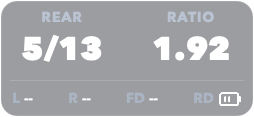

# Shifting HUD

Shimano Di2 や SRAM AXS などの電動コンポーネントが送信する **ANT+ Shifting プロファイル（Device Type `0x22` / `34`）** を受信し、現在のギア位置・ギア比・各バッテリー状態を最前面の角丸透過 HUD として表示する Python デスクトップアプリケーションです。

## 特徴・表示内容

- **ウィンドウ特性**: 最前面固定・フレームレス・角丸半透明背景・非透過テキスト
- **メインコンテンツ**
  - `FRONT`: フロントギア位置 `<現在のギア>/<段数>`（未受信時は `-`。FD 非装着のフロントシングル等でリアのみ取得できている場合は非表示）
  - `REAR`: リアギア位置 `<現在のギア>/<段数>`（未受信・無効時は `-`）
  - `RATIO`: 現在のフロント歯数 / リア歯数から算出したギア比（フロントギア情報が取得できない場合は `teeth.front[0]` を使用。`teeth` 未設定時や範囲外の場合は非表示）
- **サブコンテンツ（バッテリー状態）**
  - `L`: 左シフター（`New` / `Good` / `Ok` / `Low` / `Critical` / `Charging` または `-`）
  - `R`: 右シフター
  - `FD`: フロントディレイラー
  - `RD`: リアディレイラー
- **自動リセット**: デバイス切断時や一定時間（デフォルト 30 秒）通信が途絶えた場合は自動的に `-` 表示へリセットされます。

### スクリーンショット

|     フロントダブル（2x12s 構成）     |    フロントシングル（1x13s 構成）    |      歯数設定なし（ギア比非表示）       |
| :----------------------------------: | :----------------------------------: | :-------------------------------------: |
|  |  |  |

______________________________________________________________________

## セットアップ

受信には ANT+ 対応 USB ドングル（ANTUSB2 / ANTUSB-m 等）が必要です。
また、Python 仮想環境（[venv](https://docs.python.org/ja/dev/library/venv.html)）の利用を推奨します。

### 1. 仮想環境の作成と有効化

```bash
# 仮想環境の作成
python -m venv .venv

# 仮想環境の有効化
# POSIX (bash/zsh):
source .venv/bin/activate

# Windows (cmd.exe):
.\.venv\Scripts\activate.bat

# Windows (PowerShell):
.\.venv\Scripts\Activate.ps1
```

> [!NOTE]
> 仮想環境の詳細や各シェルでの有効化コマンドについては、Python 公式ドキュメントの [venv --- 仮想環境の作成](https://docs.python.org/ja/dev/library/venv.html) を参照してください。

### 2. 依存パッケージのインストール

仮想環境を有効化した状態で、以下のコマンドを実行します：

```bash
pip install PySide6 openant
```

開発ツール（`ruff`, `mypy`, `pytest`）もあわせて導入する場合：

```bash
pip install ruff mypy pytest
```

______________________________________________________________________

## 設定方法 (`settings.json`)

ANT+ ID の固定やギア比（`RATIO`）表示を行う場合は、`settings.schema.json` のスキーマ定義に従って、実行ディレクトリ（または実行ファイルと同じディレクトリ）に `settings.json` を作成します。
`settings.json` は必須ではなく、ファイルが存在しない場合はデフォルトで `antID = 0`（最初に見つかった Shifting デバイスに接続・歯数設定なし）として動作します。

### 設定例（フロントダブル 2x12s）

歯数（`teeth.front`, `teeth.rear`）は慣例通り**重いギアから順**（フロントはアウター→インナーの降順、リアはトップ→ローの昇順）で記述します。アプリケーション内部で ANT+ のギア番号（`1` = 最内側・最軽ギア）に合わせてソートして参照されます。

```json
{
  "antID": 0,
  "teeth": {
    "front": [50, 34],
    "rear": [11, 12, 13, 14, 15, 17, 19, 21, 24, 27, 30, 34]
  }
}
```

### 設定例（フロントシングル 1x13s）

```json
{
  "antID": 12345,
  "teeth": {
    "front": [46],
    "rear": [10, 11, 12, 13, 15, 17, 19, 21, 24, 28, 32, 38, 46]
  }
}
```

### 設定項目一覧

| プロパティ    | 型                      | 必須 | 説明                                                                                           |
| :------------ | :---------------------- | :--: | :--------------------------------------------------------------------------------------------- |
| `antID`       | `number` (`0`〜`65535`) |  ✅  | 接続する ANT+ デバイス ID。`0` を指定すると最初に見つかった Shifting デバイスに接続します。    |
| `teeth.front` | `number[]`              |  -   | フロントチェーンリングの歯数配列（例: `[50, 34]`、フロントシングルの場合は `[46]`）。          |
| `teeth.rear`  | `number[]`              |  -   | リアカセットスプロケットの歯数配列（例: `[11, 12, 13, 14, 15, 17, 19, 21, 24, 27, 30, 34]`）。 |

> [!NOTE]
> `teeth`（または `front` / `rear`）を省略した場合、HUD 上の `RATIO`（ギア比）は表示されず、`FRONT` と `REAR` の段数表示のみで動作します。

### `settings.json` の探索優先順位

1. コマンドライン引数 `-s` / `--settings` で指定されたパス
2. カレントワーキングディレクトリ (`./settings.json`)
3. アプリケーションの配置ディレクトリ（PyInstaller で exe 化した場合は実行ファイルと同じディレクトリ、通常実行時は `main.py` と同じディレクトリ）
4. 上記のいずれにも存在しない場合（`-s` 未指定時）は、`{"antID": 0}` 相当のデフォルト設定が適用されます。

______________________________________________________________________

## 起動と操作方法

### 起動

```bash
python main.py
```

オプション：

- `-s PATH`, `--settings PATH`: 設定ファイルのパスを明示的に指定
- `--debug`: デバッグログ出力を有効化
- `--demo`: ANT+ ハードウェアを使用せず、ダミーデータ（ギア段数・ギア比・バッテリー状態）を表示して起動（動作確認や画面確認用）

### スクリーンショットの生成（撮影用ツール）

ANT+ デバイス未接続の状態で、現在の設定に応じたダミーデータをもとに角丸半透明の PNG 画像を直接生成・保存できます：

```bash
# デフォルトで ./screenshot.png に保存
python capture.py

# 出力先を指定する場合
python capture.py -o screenshot.png
```

### HUD ウィンドウの操作

- **移動**: ウィンドウ上をマウス左ボタンドラッグ
- **終了**:
  - ウィンドウ上で右クリック → `Quit`
  - ウィンドウ選択中に `Esc` キーまたは `Q` キー

______________________________________________________________________

## 開発ツールの使い方

本プロジェクトではコード品質管理およびテストに `ruff`、`mypy`、`pytest` を使用しています。設定は `pyproject.toml` に集約されています。

### 1. リント・フォーマット（Ruff）

```bash
# リントチェック
ruff check .

# 自動修正付きリントチェック
ruff check --fix .

# コードフォーマットの適用
ruff format .

# フォーマット差分の確認（CI / コミット前確認用）
ruff format --check .
```

### 2. 静的型チェック（Mypy）

`strict = true` モードで型検査を実行します：

```bash
mypy .
```

### 3. 単体テスト（Pytest）

設定バリデーション、ギア比計算、ANT+ パケットデコード、ウォッチドッグ、HUD 描画の単体テストを実行します：

```bash
pytest
```

______________________________________________________________________

## ライセンス

本プロジェクトは [MIT License](LICENSE) の下で公開されています。

Copyright (c) Ryusuke SEKIYAMA \<rsky0711@gamil.com>
